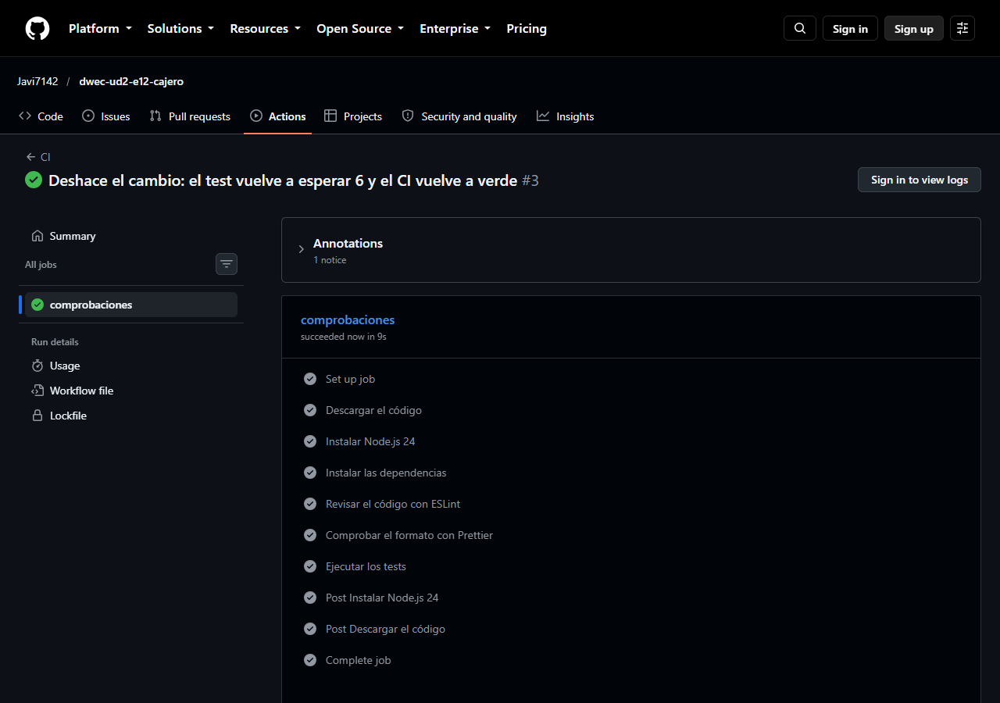
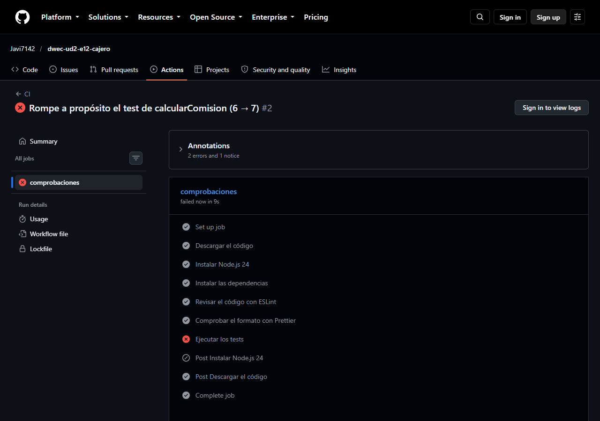

# Cajero automático

Programa de consola que simula una sesión en un cajero automático: valida importes escritos como texto, calcula comisiones, desglosa billetes y procesa una lista de operaciones (`consultar`, `ingresar`, `retirar`, `salir` y operaciones desconocidas).

Repositorio con el historial de commits: <https://github.com/Javi7142/dwec-ud2-e12-cajero>

## Por qué JavaScript

El proyecto es un programa pequeño (unas cien líneas de lógica) que hace cálculos sencillos con números y textos y que se escribe y se prueba **sin compilar**: el mismo `js/main.js` se ejecuta con Node.js (`npm start`) y en el navegador (`index.html` lo carga como módulo), y JavaScript es el único lenguaje que ofrece ese doble entorno sin pasos previos, que son los dos primeros criterios del tema 1 (el **entorno de ejecución** y la **simplicidad del flujo de trabajo**). Además, no hay cálculo pesado que justifique WebAssembly (desglosar un importe son cuatro divisiones), y TypeScript aportaría tipos y un paso de compilación que aquí no compensan: los tipos ya se documentan con JSDoc y los errores de datos se cubren con la validación de `validarImporte` y con los tests. Cambiaría a **TypeScript** si el cajero creciera (varios tipos de tarjeta, muchas pantallas, un equipo de varias personas) porque los tipos detectarían antes errores como pasar un texto donde se espera un número, y a **WebAssembly** solo si hubiera que hacer cálculos muy pesados (por ejemplo, procesar millones de movimientos).

## Cómo ejecutarlo

```bash
npm install            # instalar las dependencias (el contenedor ya lo hace al crearse)
npm start              # ejecutar la sesión en Node.js (node js/main.js)
npm test               # ejecutar los tests con Vitest
npm run lint           # revisar el código con ESLint
npm run format:check   # comprobar el formato con Prettier (npm run format lo aplica)
```

**En el navegador:** se sirve la carpeta con `npx --yes serve@14.2.6 --no-clipboard .`, se abre la dirección que muestre (por ejemplo `http://localhost:3000`) y se abre la consola de las DevTools (`F12`), que muestra la misma sesión que `npm start`. No se abre con doble clic (`file://`), porque el navegador no carga módulos desde ahí.

Salida de `npm start`:

```text
🏧 Bienvenida, Lucía (no cliente)
1. consultar → Saldo: 250.00 €
2. retirar 60 € → ✅ 1 x 50 € + 1 x 10 € · comisión: 1.50 € · saldo: 188.50 €
3. retirar 72 € → ❌ Debe ser múltiplo de 5 y no superar 600 €
4. ingresar 100.50 € → ✅ Saldo: 289.00 €
5. retirar → ❌ Importe no válido: "cien"
6. retirar 300 € → ❌ Saldo insuficiente (comisión: 6.00 €)
7. transferir → ❌ Operación desconocida
8. retirar 700 € → ❌ Debe ser múltiplo de 5 y no superar 600 €
9. salir → 👋 Sesión terminada
Operaciones realizadas: 9 · saldo final: 289.00 €
```

## Decisiones de diseño

| Nombre | Fichero | Declaración | Ámbito | Por qué |
|--------|---------|-------------|--------|---------|
| `BILLETES` | `cajero.js` | `const` | Módulo (exportada) | Son datos fijos del cajero que usa `desglosarBilletes` y que `main.js` o los tests pueden importar; al estar en una constante con nombre, cambiar los billetes es tocar un solo sitio |
| `LIMITE_RETIRADA` | `cajero.js` | `const` | Módulo (exportada) | La usan `esRetirable` y el mensaje de error de `main.js` (`no superar 600 €`), y los tests; una sola constante evita repetir el número 600 y que se desincronicen |
| `MAX_OPERACIONES` | `main.js` | `const` | Módulo | Límite de la sesión que no cambia; solo lo usa `main.js`, así que no se exporta ni vive en `cajero.js` |
| `saldo` | `main.js` | `let` | Módulo | Es lo único que cambia durante la sesión (se descuenta al retirar y se suma al ingresar), así que necesita `let`; está fuera del bucle porque tiene que conservar su valor entre operaciones |
| `operacionesRealizadas` | `main.js` | `let` | Módulo | Contador que se incrementa en cada vuelta y que se muestra en el resumen **después** del bucle, por lo que no puede declararse dentro de él |
| `operacion` | `main.js` | `const` | Bloque del `for…of` | Cada vuelta tiene su propia operación y no se reasigna; vive solo dentro del bucle |
| `prefijo` | `main.js` | `const` | Bloque del `for…of` | Texto `N. tipo` de la línea de salida, calculado una vez por vuelta y compartido por todos los `case`; no se reasigna |
| `importe` | `main.js` | `const` | Bloque del `case 'retirar'` (llaves) y del `case 'ingresar'` | Resultado de `validarImporte` para esa operación. Se declara con llaves en cada `case` para que sea de **ámbito de bloque**: si no, los dos `const importe` chocarían en el mismo ámbito del `switch` |
| `comision` | `main.js` | `const` | Bloque del `case 'retirar'` | Solo existe al retirar y se usa dos veces (comprobar el saldo y mostrarla); no cambia una vez calculada |
| `limpio` | `cajero.js` | `const` | Función `validarImporte` | El texto sin espacios, solo necesario dentro de la función; así no se modifica el parámetro `texto` |
| `restante` | `cajero.js` | `let` | Función `desglosarBilletes` | Es lo que queda por repartir y baja con cada billete usado, así que se reasigna (por eso `let`); no puede ser global porque cada llamada empieza con su propio importe |
| `partes` | `cajero.js` | `const` | Función `desglosarBilletes` | Array al que solo se añaden elementos (`push`): la variable no se reasigna, aunque el contenido cambie, por lo que basta `const` |

## Conversiones y validación

`validarImporte(texto)` convierte el texto que escribe el usuario en un número (`Number`, explícito) y devuelve `null` si no sirve. Pasos con cada entrada:

| Entrada | Pasos | Resultado |
|---------|-------|-----------|
| `' 100,50 '` | `trim()` quita los espacios → `'100,50'`; no está vacío; `replace(',', '.')` → `'100.50'`; `Number('100.50')` es `100.5`, un número finito mayor que 0 | `100.5` |
| `''` | `trim()` da `''`: se devuelve `null` **antes** de convertir | `null` |
| `'cien'` | `trim()` → `'cien'`; no está vacío; `Number('cien')` es `NaN`, que no es finito | `null` |
| `'-20'` | `Number('-20')` es `-20`: es un número finito pero no es mayor que 0 | `null` |
| `'  40 '` | `trim()` → `'40'`; `Number('40')` es `40`, finito y mayor que 0 | `40` |

**El texto vacío se comprueba aparte** porque `Number('')` da `0` (y `Number('   ')` también): no es un error de conversión, así que `Number.isFinite` lo dejaría pasar como un número válido y solo el filtro «mayor que 0» lo rechazaría por casualidad; comprobarlo explícitamente deja claro el motivo y evita que un campo sin rellenar se tome por un `0`. **No se usa `parseFloat`** porque lee un número del principio del texto y se calla el resto: `parseFloat('50€')` daría `50` y `parseFloat('12abc')` daría `12`, de modo que se aceptarían importes mal escritos; `Number` solo acepta el texto entero (`Number('50€')` es `NaN`). La coma se cambia por el punto porque `Number` solo entiende el punto decimal (`Number('100,50')` es `NaN`).

## Pruebas realizadas

Salida de `npm test` (25 tests en cuatro `describe`):

```text
RUN  v5.0.5
 ✓ js/cajero.test.js > validarImporte > convierte un importe con espacios y coma decimal 1ms
 ✓ js/cajero.test.js > validarImporte > acepta el punto como separador decimal 0ms
 ✓ js/cajero.test.js > validarImporte > ignora los espacios de alrededor (caso límite) 0ms
 ✓ js/cajero.test.js > validarImporte > devuelve null con el texto vacío o solo espacios (caso límite) 0ms
 ✓ js/cajero.test.js > validarImporte > devuelve null si no es un número 0ms
 ✓ js/cajero.test.js > validarImporte > devuelve null si no es mayor que 0 (caso límite: 0 y negativos) 0ms
 ✓ js/cajero.test.js > validarImporte > devuelve null con valores infinitos 0ms
 ✓ js/cajero.test.js > esRetirable > acepta un entero múltiplo de 5 0ms
 ✓ js/cajero.test.js > esRetirable > rechaza un importe que no es múltiplo de 5 0ms
 ✓ js/cajero.test.js > esRetirable > acepta justo el importe máximo (caso límite) 0ms
 ✓ js/cajero.test.js > esRetirable > rechaza un importe por encima del máximo (caso límite: 605) 0ms
 ✓ js/cajero.test.js > esRetirable > rechaza un importe con decimales aunque se acerque a un múltiplo de 5 0ms
 ✓ js/cajero.test.js > esRetirable > acepta el billete más pequeño (caso límite: 5) 0ms
 ✓ js/cajero.test.js > calcularComision > cobra el 2 % cuando supera el mínimo 0ms
 ✓ js/cajero.test.js > calcularComision > cobra el mínimo cuando el 2 % es menor (caso límite: 60 €) 0ms
 ✓ js/cajero.test.js > calcularComision > en el punto en que el 2 % iguala al mínimo (75 €) cobra 1,5 € (caso límite) 0ms
 ✓ js/cajero.test.js > calcularComision > no cobra nada a los clientes del banco 0ms
 ✓ js/cajero.test.js > calcularComision > redondea la comisión a céntimos 0ms
 ✓ js/cajero.test.js > calcularComision > cobra 12 € con la retirada máxima de 600 € (caso límite) 0ms
 ✓ js/cajero.test.js > desglosarBilletes > usa el menor número de billetes 0ms
 ✓ js/cajero.test.js > desglosarBilletes > usa los cuatro tipos de billete cuando hace falta 0ms
 ✓ js/cajero.test.js > desglosarBilletes > desglosa un importe que es un solo billete (caso límite: 5) 0ms
 ✓ js/cajero.test.js > desglosarBilletes > devuelve texto vacío con 0 € (caso límite) 0ms
 ✓ js/cajero.test.js > desglosarBilletes > desglosa el importe máximo solo con billetes de 50 (caso límite) 0ms
 ✓ js/cajero.test.js > desglosarBilletes > no usa billetes de 5 si bastan los de 10 (no hay 2 x 5 + 1 x 10) 0ms
 Test Files  1 passed (1)
      Tests  25 passed (25)
   Start at  13:37:03
   Duration  149ms (import 41%, transform 27%, tests 16%, worker 15%, environment 1%)
```

| Función | Casos límite que pruebo | Por qué |
|---------|-------------------------|---------|
| `validarImporte` | Texto vacío y solo espacios, `'0'` y negativos, espacios alrededor, `'50€'` e `'Infinity'` | Son los puntos donde `Number` y el filtro «mayor que 0» podrían dejar pasar un valor no válido (`Number('')` da 0, `Number('Infinity')` es un número) y los textos que `parseFloat` habría aceptado a medias |
| `esRetirable` | Justo el máximo (`600`), justo por encima (`605` y `700`), el billete más pequeño (`5`) y un decimal cercano (`62.5`) | Los límites del rango son donde se equivoca un `<` por un `<=`; el decimal comprueba que se exige un entero |
| `calcularComision` | `60 €` (el 2 % da 1,20 y se aplica el mínimo de 1,50), `75 €` (justo donde el 2 % iguala al mínimo), `600 €` (comisión máxima: 12 €), clientes (0 €) y un importe que obliga a redondear | La frontera entre «el mínimo» y «el 2 %» es donde cambia la fórmula, y el redondeo evita decimales no exactos |
| `desglosarBilletes` | `0 €` (texto vacío), `5 €` (un solo billete), `600 €` (solo billetes de 50: `12 x 50 €`) y `20 €` (no usar billetes de 5 si bastan otros) | El 0 es el caso en el que no se usa ningún billete; los extremos del rango comprueban que no se repite ni se omite ningún billete, y el 20 comprueba que se prefieren los billetes grandes |

Comprobación de que los tests detectan cambios: al subir `COMISION_MINIMA` de 1,5 a 2 falla `calcularComision › en el punto en que el 2 % iguala al mínimo (75 €)`; se deshizo y los 25 tests vuelven a pasar.

**Sesión sin `salir` que alcanza `MAX_OPERACIONES`.** Se cambió temporalmente `operaciones` por una lista de **12 operaciones** sin `salir` (un `consultar`, un `retirar` de `'5'` y diez `consultar`). El programa procesó las 10 primeras y mostró:

```text
8. consultar → Saldo: 243.50 €
9. consultar → Saldo: 243.50 €
10. consultar → Saldo: 243.50 €
⚠️ Máximo de operaciones alcanzado
Operaciones realizadas: 10 · saldo final: 243.50 €
```

Las operaciones 11 y 12 no se procesan. (El saldo es `243.50 €` porque retirar 5 € cuesta la comisión mínima de 1,50 €.) Con una lista en la que `salir` es justo la operación 10, la sesión termina con `👋 Sesión terminada` y sin el aviso. Los datos se dejaron después como estaban.

## Herramientas

Salida al terminar:

```text
> npm run lint
> eslint .

> npm run format:check
Checking formatting...
All matched files use Prettier code style!
```

**Un problema que encontré mientras programaba.** Al ejecutar `npm start` por primera vez con `main.js` completo, la sesión se detuvo en la tercera operación con `ReferenceError: LIMITE_RETIRADA is not defined`, justo al mostrar el mensaje de rechazo `Debe ser múltiplo de 5 y no superar 600 €`. La consola daba el fichero y la línea (`main.js:64`) y la salida anterior mostraba que las dos primeras operaciones sí funcionaban. La causa era que `LIMITE_RETIRADA` está declarada y exportada en `cajero.js`, pero yo la había usado en `main.js` sin añadirla al `import` (en un módulo, lo que no se importa no existe en ese fichero). La solución fue añadir `LIMITE_RETIRADA` a la lista del `import`. ESLint lo habría detectado antes de ejecutar con la regla `no-undef`.

## Integración continua (opcional)

- Ejecución en verde (6 pasos): <https://github.com/Javi7142/dwec-ud2-e12-cajero/actions/runs/39772255113>



Captura de la ejecución en verde: los seis pasos del trabajo (descargar el código, instalar Node.js 24, instalar las dependencias, ESLint, Prettier y tests) terminan bien.

**Ejecución en rojo provocada a propósito.** Se cambió el valor esperado del test de `calcularComision` (`toBe(6)` por `toBe(7)` en `calcularComision(300, false)`), se subió el cambio y la ejecución ([#2](https://github.com/Javi7142/dwec-ud2-e12-cajero/actions/runs/39772118265)) falló en el paso **Ejecutar los tests** con `AssertionError: expected 6 to be 7` (24 tests pasan y 1 falla); ESLint y Prettier pasaron. Después se deshizo el cambio y la ejecución volvió a verde.



En la captura se ve el paso **Ejecutar los tests** en rojo; el paso final de limpieza de Node.js queda saltado.
